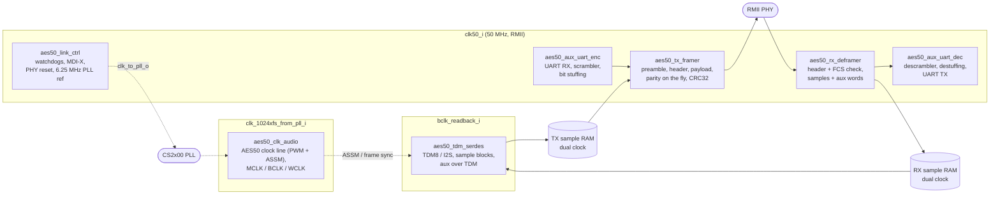

# AES50 VHDL IP – v2

v2 is a re-implementation of the original [AES50 IP](https://github.com/YetAnotherElectronicsChannel/AES50).
- **Same function, same top-level ports:** only `clk100_i` was removed.
- **No 100 MHz clock any more:** the Ethernet side runs on the 50 MHz RMII clock, the audio side on the 1024xfs PLL clock and the TDM SerDes on BCLK.
- **Much smaller:** about 40 % of the logic and a third of the block RAM of v1 (Reference:Trion T20 FPGA)

The goal of v2 is a core that also synthesizes well on the older / constrained FPGAs of the [OpenX32 project](https://github.com/OpenMixerProject/OpenX32), the Lattice ECP5 and the Xilinx Spartan-3A.

## What is new in v2

| | v1 | v2 |
|---|---|---|
| Clocks | 100 MHz core + 50 MHz RMII + 1024xfs | 50 MHz RMII + 1024xfs + TDM/I2S BCLK |
| TX/RX architecture | frame assembled in a large RAM, complex state-machine (reorder, parity, global parity), ~75 µs processing per frame at 100 MHz | streaming: the frame is generated directly while it is sent, parity is calculated on the fly |
| TDM SerDes | clocked by 100MHz, 256-bit shifters | clocked directly by BCLK, 7 × 24-bit shifters |
| Startup alignment to the ASSM | timer values `first_transmit_start_counter_*` | sample-exact in the TDM interface, the timer values are ignored |
| Configuration | fixed | generics, e.g. 48k only, no aux-over-TDM, smaller UART FIFOs, TDM frame-sync delay |

## About the v2 IP
- Same featureset as v1
- Compatibility / Real-Life Tested
  - tested in simulation:
    - against v1 in both directions (v1 as master and as slave, audio and aux)
    - against Wireshark captures of an X32 / DL32 combination (44.1k/48k)
  - all functionality practically tested against Wing-Rack and DL32 stagebox
  - unfortunately I don't have X32 at home - so that's up to the OpenX32 guys

### IP Internal Structure

### Module overview

| File | Function |
|---|---|
| `aes50_top.vhd` | top level: same ports as v1 without `clk100_i` (thin wrapper around `aes50_core`) |
| `aes50_core.vhd` | the core: resets, clock domain crossings, wiring of the modules |
| `aes50_pkg.vhd` | header, block/LC mapping, bit layout, CRC32 |
| `aes50_dpram.vhd` | simple dual-port RAM (inference template) |
| `aes50_fifo.vhd` | FIFO (UART buffers, aux input of the decoder) |
| `aes50_tx_framer.vhd` | RMII transmit stream directly from the sample RAM, parity on the fly |
| `aes50_rx_deframer.vhd` | RMII receive directly into the sample RAM |
| `aes50_link_ctrl.vhd` | watchdogs, MDI-X, 6.25 MHz PLL reference |
| `aes50_aux_uart_enc.vhd` / `_dec.vhd` | aux channel ↔ UART (scrambler, bit stuffing, delimiter) |
| `aes50_uart.vhd` | UART RX/TX |
| `aes50_clk_audio.vhd` | AES50 clock line with ASSM, MCLK/BCLK/WCLK |
| `aes50_tdm_serdes.vhd` | TDM8/I2S SerDes, sample blocks, RX playout, aux over TDM |
| `aes50_cs2x00_pll_controller.vhd` / `aes50_i2c_master.vhd` | CS2x00 init over I2C (100 kHz) |

### Top-Module Generics
The defaults give the same feature set of v1.

| Generic | Default | Description |
|---|---|---|
| **G_SUPPORT_44K1** | `true` | `false`: 48k only, half-size sample RAMs |
| **G_UART_AUX** | `true` | aux channel over UART (`false` removes encoder, decoder and FIFOs) |
| **G_TDM_AUX** | `true` | aux channel over the 7th TDM line (`false` removes the aux RAMs of the SerDes) |
| **G_UART_FIFO_AW** | `11` | UART FIFOs with 2^n − 1 bytes |
| **G_FSYNC_DELAY** | `0` | TDM: MSB of slot 0 aligned with the WCLK edge (as in v1), 1 = one BCLK later (for OpenX32 integration) |
| **G_TX_LEAD_ADJ** | `0` | fine adjustment of the TX block alignment against the ASSM, in frames (keep at 0) |
| **G_SIM_ASSM_SAMPLES** | `2048` | simulation only: shorter ASSM period |

### Top-Module Ports Description
| Signal                     | Direction | Type                          | Description                             |
| -------------------------- | -------- | ------------------------------ | --------------------------------------- |
| **clk50_i**                | in       | `std_logic`                    | 50 MHz clock (RMII reference); clocks the whole Ethernet side |
| **rst_i**                  | in       | `std_logic`                    | Reset (active high). May be asynchronous, it is synchronized internally |
| **fs_mode_i**              | in       | `std_logic_vector(1 downto 0)` | Sample-Rate Select <ul><li>00 → 44.1 kHz</li><li>01 → 48 kHz</li><li>10 → n.a.</li><li>11 → n.a.</li></ul>|
| **sys_mode_i**             | in       | `std_logic_vector(1 downto 0)` | System-Mode Select <ul><li>00 → AES50 Slave & I2S/TDM Master</li><li>01 → AES50 Master & I2S/TDM Master</li><li>10 → AES50 Master & I2S/TDM Slave</li><li>11 → n.a.</li></ul>|
| **tdm8_i2s_mode_i**        | in       | `std_logic`                    | Interface Select <ul><li>0 → 48x48 TDM8 (Support for Aux-over-TDM)</li><li>1 → 2x2 I2S (only Aux-over-UART)</li></ul>|
| **aux_tx_tdm_uart_select_i**| in       | `std_logic`                   | Aux-Data-Mode  <ul><li>0 → Aux-over-TDM</li><li>1 → Aux-over-UART</li></ul>|
| **rmii_crs_dv_i**          | in       | `std_logic`                    | RMII Data Valid Receive from PHY        |
| **rmii_rxd_i**             | in       | `std_logic_vector(1 downto 0)` | RMII Data from PHY                      |
| **rmii_tx_en_o**           | out      | `std_logic`                    | RMII Data Valid Transmit to PHY         |
| **rmii_txd_o**             | out      | `std_logic_vector(1 downto 0)` | RMII Data to PHY                        |
| **phy_rst_n_o**            | out      | `std_logic`                    | PHY Reset (active low, held for 1 ms after reset) |
| **aes50_clk_a_rx_i**       | in       | `std_logic`                    | AES50 Clock A Receive                   |
| **aes50_clk_a_tx_o**       | out      | `std_logic`                    | AES50 Clock A Transmit                  |
| **aes50_clk_a_tx_en_o**    | out      | `std_logic`                    | AES50 Clock A Enable LVDS Output Driver      |
| **aes50_clk_b_rx_i**       | in       | `std_logic`                    | AES50 Clock B Receive                   |
| **aes50_clk_b_tx_o**       | out      | `std_logic`                    | AES50 Clock B Transmit                  |
| **aes50_clk_b_tx_en_o**    | out      | `std_logic`                    | AES50 Clock B Enable LVDS Output Driver      |
| **clk_1024xfs_from_pll_i** | in       | `std_logic`                    | Clock from external PLL (1024× fs)      |
| **pll_lock_n_i**           | in       | `std_logic`                    | External PLL Lock Status (active low)   |
| **clk_to_pll_o**           | out      | `std_logic`                    | Clock to external PLL                   |
| **pll_mult_value_o**       | out      | `natural`                      | External PLL multiplication-factor      |
| **pll_init_busy_i**        | in       | `std_logic`                    | PLL init busy status                    |
| **mclk_o**                 | out      | `std_logic`                    | Master Clock (256x fs) - derived (divided by x4) from PLL - independent of System-Mode Select |
| **wclk_o**                 | out      | `std_logic`                    | Word Clock Output (if our IP is I2S/TDM Master)   |
| **bclk_o**                 | out      | `std_logic`                    | Bit Clock Output  (if our IP is I2S/TDM Master)   |
| **wclk_readback_i**        | in       | `std_logic`                    | Word Clock Readback (direct from FPGA-Pin - always needed)    |
| **bclk_readback_i**        | in       | `std_logic`                    | Bit Clock Readback (direct from FPGA-Pin - always needed). **v2: clocks the TDM/I2S SerDes** |
| **wclk_out_en_o**          | out      | `std_logic`                    | Word Clock Output Enable (high if IP is I2S/TDM Master)    |
| **bclk_out_en_o**          | out      | `std_logic`                    | Bit Clock Output Enable (high if IP is I2S/TDM Master)     |
| **tdm_i**                  | in       | `std_logic_vector(6 downto 0)` | 6x TDM8 Data Input + 1x TDM8 Aux Data Input   (only needed in 48x48 mode)               |
| **tdm_o**                  | out      | `std_logic_vector(6 downto 0)` | 6x TDM8 Data Output + 1x TDM8 Aux Data Output   (only needed in 48x48 mode)                    |
| **i2s_i**                  | in       | `std_logic`                    | I2S Input  (only needed in 2x2 mode)                            |
| **i2s_o**                  | out      | `std_logic`                    | I2S Output (only needed in 2x2 mode)                             |
| **aes_ok_o**               | out      | `std_logic`                    | AES50 Link Status  (high when connection established)         |
| **dbg_o**                  | out      | `std_logic_vector(7 downto 0)` | Debug signals, see [Debug Outputs](#debug-outputs) |
| **uart_o**               	 | out      | `std_logic`                    | UART output (received data from the AES50 AUX tunnel)     |
| **uart_i**               	 | in      | `std_logic`                     | UART input (data to send over AES50 AUX-tunnel)     |
| **debug_out_signal_pulse_len_i** | in | `natural` | Pulse length of the debug pulses in 50 MHz clocks |
| **first_transmit_start_counter_48k_i** / **_44k1_i** | in | `natural` | not used in v2 (kept for port compatibility) |
| **wd_aes_clk_timeout_i**   | in | `natural` | Watchdog timeout of the received AES50 clock |
| **wd_aes_rx_dv_timeout_i** | in | `natural` | Watchdog timeout of the RMII receive data |
| **mdix_timer_1ms_reference_i** | in | `natural` | 1 ms reference of the MDI-X switching |
| **aes_clk_ok_counter_reference_i** | in | `natural` | Time the AES50 clock must be good before the link is used |
| **mult_clk625_48k_i** / **_44k1_i** | in | `natural` | CS2x00 ratio for the 6.25 MHz reference (AES master + TDM master) |
| **uart_clks_per_bit_i**    | in | `natural` | UART bit time in 50 MHz clocks |
| **uart_timeout_clks_i**    | in | `natural` | UART packet timeout in 50 MHz clocks |

#### Parameter values (v2)
All timer values count **50 MHz clocks**, i.e. half of the v1 values (v1 counted 100 MHz clocks).

| Port | Value | Meaning |
|---|---|---|
| `debug_out_signal_pulse_len_i` | 500000 | 10 ms |
| `wd_aes_clk_timeout_i` | 25 | 0.5 µs |
| `wd_aes_rx_dv_timeout_i` | 7500 | 150 µs |
| `mdix_timer_1ms_reference_i` | 50000 | 1 ms |
| `aes_clk_ok_counter_reference_i` | 500000 | 10 ms |
| `mult_clk625_48k_i` | 8246337 | unchanged, the PLL reference is still 6.25 MHz |
| `mult_clk625_44k1_i` | 7576322 | unchanged |
| `uart_clks_per_bit_i` | 434 | 115200 baud |
| `uart_timeout_clks_i` | 500000 | 10 ms |

#### Debug Outputs
| Bit | Signal |
|---|---|
| 7 | pulse: TX frame with ASSM flag sent |
| 6 | pulse: RX block with ASSM flag received |
| 5 | pulse: ASSM on the AES50 clock line |
| 4 | `rmii_crs_dv_i` |
| 3 | `rmii_tx_en_o` |
| 2 | transmitter started (aligned to the ASSM) |
| 1 | receive path OK |
| 0 | MCLK |

The pulses are stretched to `debug_out_signal_pulse_len_i`.

#### BCLK as clock (v2)
In v2, the TDM/I2S SerDes is clocked directly by `bclk_readback_i`, in all system modes.
- **Edges:** Data is shifted out on the falling edge and sampled on the rising edge.
- **Clock pin:** Ideally `bclk_readback_i` comes from a clock-capable pin. If it does not, the tools route it through the fabric onto the global clock network. This adds some insertion delay, which is uncritical for TDM: half a BCLK period is 40.7 ns at 12.288 MHz.
- **Constraint:** Put a `create_clock` on the BCLK pin (worst case 12.288 MHz).

### FPGA Resource Utilization
This is the resource utilization of the eval top on the reference FPGA: full configuration (all sample-rates and operation modes, dual TDM/I2S support, aux over TDM and UART, PLL-I2C driver).
Resource utilization depends on the actual configuration (see generics).

Reference FPGA: Efinix Trion T20Q100F3 (Speedgrade: 4) using Efinity 2026.1.132.

| | v1 | v2 |
|---|---|---|
| Logic Elements | 10433 / 19728 | 4144 / 19728 (2889 LUT4, 2205 FF) |
| Memory Blocks | 69 / 204 | 24 / 204 |
| Multipliers | 7 / 36 | 0 / 36 |
| Fmax CLK_100M (required 100 MHz) | 105.1 MHz | – (not used) |
| Fmax CLK_50M (required 50 MHz) | 98.7 MHz | 98.1 MHz |
| Fmax APLL_MCLK (required 49.152 MHz) | 116.1 MHz | 125.2 MHz |
| Fmax TDM_BCLK_IN (required 12.288 MHz) | – (not a clock) | 59.3 MHz |

For comparison, the core alone in Vivado (Artix-7 as reference only, same feature set): v1 4673 LUT / 5098 FF / 10 BRAM, v2 1985 LUT / 2011 FF / 5.5 BRAM.

## Some technical implementation hints

### Streaming frame generation (replaces the RAM reorder of v1)
v1 assembled each frame in a large LC-RAM and then ran several passes over it (sample write, reorder, parity, global parity). This took about 7500 clocks per frame and was the reason for the 100 MHz clock. v2 generates the frame while it is being sent. Two observations make this possible:
- **Parity on the fly:**
  - The payload is 11 rows × 32 blocks × 32-bit words, sent row by row, LSB first.
  - Each parity block (15, 23, 27, 29, 30) is the XNOR of all earlier blocks of the same row whose block number has a 0 at the parity block's zero bit. Block 31 is the XNOR of blocks 0..30.
  - Every parity block therefore only depends on blocks that were already sent in the same row. Six 32-bit accumulators replace all parity passes.
- **One RMII dibit = one bit of a channel pair:**
  - An LC carries two channels bit-interleaved (a23 b23 a22 b22 …). RMII transfers exactly one dibit per 50 MHz clock.
  - The framer picks the two bits directly from the 24-bit samples, using a position counter and a small table. No frame RAM needed.

The receiver works the same way in reverse. Its only buffer is a small LC context RAM, which keeps a sample pair that is split across two rows.

### Startup Sequencing
The Ethernet frame containing the "2048x ASSM-marker" in the header must be tightly aligned with the modulated clock pulses on the LVDS signaling.
- **v1** waited for the clock pulse modulation and then started a timer (the `first_transmit_start_counter_*` values) to start the TX FIFO at the right time.
- **v2** does this sample-exact in the TDM interface.
  - After the transmitter is enabled, the first sample block starts N frames before the next ASSM event (N = 6 at 48k, 11 at 44k1). The block with the ASSM flag therefore ends exactly at the ASSM.
  - From then on, every N frames form one block. Every 1024th frame (48k) or every 2048th block (44k1, two frames per block) carries the ASSM flag.
  - This is independent of clock frequencies, so the timer values are no longer needed.

### Latency
In general, the v2 keeps the approach of processing the audio-samples internally in blocks of 6 samples at 48k or 11 samples at 44k1.
  - Measured in the system simulation (TDM input of one core to TDM output of the other core, MSB of slot 0 to MSB of slot 0): **exactly 12 samples at 48k and 22 samples at 44k1**, i.e. two sample blocks, the same for every channel and constant over the whole run.
  - It is made up of:
    1. collecting one block from the TDM input (6 @ 48k or 11 @ 44k1 samples: 125 / 249.4 µs);
    2. sending it over the wire (48k: one frame of 1442 bytes at 100 Mbit/s = 115.4 µs; 44k1: two frames 124.4 µs apart = 239.7 µs);
    3. clock domain crossings
    4. waiting for the next TDM frame start, from which the block is played out (48k ~9.4 µs, 44k1 ~9.8 µs).
  - Step 4 rounds the latency up to a whole number of samples. 
  - v2 no longer adds the ~75 µs per frame that v1 needed to assemble the frame in RAM.

## License

Copyright (c) 2026 Markus Noll (YetAnotherElectronicsChannel)

This IP core is free software: you can redistribute it and/or modify
it under the terms of the GNU General Public License as published by
the Free Software Foundation, either version 3 of the License, or
(at your option) any later version.

This IP core is distributed in the hope that it will be useful,
but WITHOUT ANY WARRANTY; without even the implied warranty of
MERCHANTABILITY or FITNESS FOR A PARTICULAR PURPOSE. See the
GNU General Public License for more details.

You should have received a copy of the GNU General Public License
along with this IP core. If not, see <https://www.gnu.org/licenses/>.

Third-party components included in this repository may be licensed under
different terms (for example, GPLv3). These components retain their
original licenses and are clearly marked in the source header.
